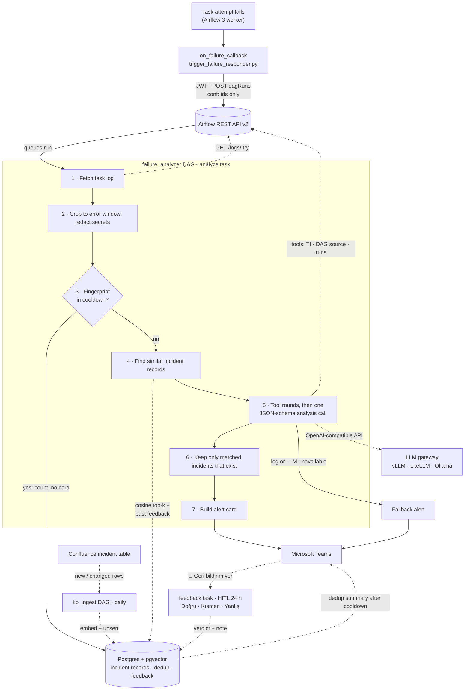

# Airflow Failure Responder

When an Airflow task fails, this system reads the task log, finds similar past incidents in your Confluence incident table, asks an LLM for the root cause and fix, and posts an **alert card** to Microsoft Teams. If the analysis cannot be produced, it still posts a **fallback alert** with the last error line, so a failure is never silent. Repeats of the same error are grouped into one card plus a **dedup summary**, and the team's **feedback** on an analysis is reused the next time the same error comes back.

Built for Airflow 3 (REST API v2, FAB auth) and any OpenAI-compatible LLM gateway (vLLM, LiteLLM, Ollama). Logs and DAG source are redacted before they reach the LLM, and nothing is sent to an external service unless you point the gateway there.

Terms in **bold** are defined in [GLOSSARY.md](GLOSSARY.md).

## How it works



1. **Callback** (runs inside the failed task's worker): gets a JWT from `/auth/token` and triggers one `failure_analyzer` DAG run. The run's `conf` holds only the DAG, run, task and try number. The run id is fixed per failed try, so a repeated callback does not analyze twice.
2. **Analyzer task**: reads the Variable for settings and Airflow Connections for secrets, gets its own JWT, and runs the steps in the box. It has Airflow retries, shows up in the Airflow UI, and at most 4 run at once to protect the LLM gateway.
3. **Task log**: fetched from `/api/v2/.../logs/{try}`, cropped to the window around the error, then secrets (passwords, tokens, connection strings, emails, keys) are redacted.
4. **Dedup**: the last error line gives a **fingerprint** (exception type + message without ids, numbers, timestamps; the same across all DAGs). The first failure of a fingerprint is analyzed; repeats within a 30-minute cooldown get no LLM call and no card, only a count. After the cooldown one **dedup summary** card lists the affected tasks.
5. **Knowledge base**: the daily `kb_ingest` DAG stores the rows of the Confluence incident table in Postgres + pgvector. Only new or changed rows are embedded; rows removed from the page are deleted. The analyzer only reads it, so a Confluence outage never delays an alert.
6. **Analysis**: the model may first read Airflow context through read-only tools (task instance, redacted DAG source, last successful run, other failures in the run). The closest incident records go into the prompt as `K1..Kn`, together with the team's latest feedback on the same fingerprint. The LLM returns a structured analysis and the IDs it used. The code maps those IDs back to real records, so a **matched incident** on the card can't be invented.
7. **Alert card**: posted to a Teams Workflows (Power Automate) webhook.
8. **Feedback**: after an LLM analysis the run waits up to 24 hours on a human-in-the-loop step, opened from the card. `Doğru` / `Kısmen` / `Yanlış` plus a note are stored; no answer is stored as `unanswered`. The next analysis of the same fingerprint builds on a confirmed explanation and avoids a rejected one.

## What the alert card shows

| Section | Content |
|---|---|
| Header | Error summary (one sentence), DAG |
| 🎯 Kök Neden | **Root cause**, not the symptom |
| 📄 Kullanılan Dokümanlar | **Matched incidents** (date · service · summary) |
| 📚 Knowledge Kaynaklı Öneriler | Fix steps taken from matched incidents only |
| 🔧 Genel Öneriler | General fix steps |
| 🛡️ Önleme | Prevention |
| Detaylar (toggle) | DAG, task, run, try, needs rerun, confidence |
| Buttons | Log in the Airflow UI, Confluence page (if configured), 📝 Geri bildirim ver (LLM analyses only) |

A **fallback alert** has the same layout with the last error line as summary and no feedback button. A **dedup summary** card shows the fingerprint's error line, the time window, the count and the first 20 affected tasks. Card text and the LLM prompt are in Turkish.

## Quick start

**1. Deploy** to the Airflow DAGs folder:

```bash
cp -r airflow_failure_responder /path/to/airflow/dags/
cp dags/callbacks/trigger_failure_responder.py /path/to/airflow/dags/callbacks/
cp dags/failure_analyzer.py dags/kb_ingest.py /path/to/airflow/dags/
pip install -r requirements.txt   # in the worker image
```

Unpause `failure_analyzer` and `kb_ingest` (new DAGs start paused), then trigger `kb_ingest` once so the knowledge base is filled before the first failure.

**2. Create the Connections** (secrets never go in the Variable; details in [docs/CONFIGURATION.md](docs/CONFIGURATION.md#connections)):

| Conn id | What to fill |
|---|---|
| `failure_responder_airflow_api` | host = Airflow API base URL, login/password of a FAB user that can read logs and DAG code and trigger DAGs (required) |
| `failure_responder_llm` | password = gateway API key |
| `failure_responder_kb_db` | Postgres with pgvector: incident records, dedup state, feedback. The role needs `CREATE` (tables are created on first use) |
| `failure_responder_confluence` | login/password |
| `failure_responder_teams` | host = full Teams webhook URL |

**3. Configure** the Airflow Variable `v_callback_fetch_failed_task` (minimal example; all keys in [docs/CONFIGURATION.md](docs/CONFIGURATION.md)):

```json
{
  "llm": { "base_url": "https://llm-gateway.example.com/v1", "model": "qwen2.5-72b-instruct" },
  "knowledge": { "embedder": { "base_url": "https://llm-gateway.example.com/v1", "id": "bge-m3" } },
  "confluence": {
    "base_url": "https://confluence.example.com",
    "page_ids": ["123456"],
    "page_url": "https://confluence.example.com/x/AbCd"
  },
  "output": { "method": "teams" }
}
```

**4. Attach** the callback to your DAGs:

```python
from callbacks.trigger_failure_responder import on_failure_trigger_fetcher

default_args = {"on_failure_callback": on_failure_trigger_fetcher}
```

Without `failure_responder_kb_db` the analysis runs from the task log alone, with no dedup and no feedback step. Without `llm.base_url` every failure gets a fallback alert.

## Repository layout

```text
dags/
├── callbacks/trigger_failure_responder.py  # on_failure_callback: JWT, trigger failure_analyzer run
├── failure_analyzer.py                     # analyzer DAG: analyze → feedback (HITL) → record_feedback
├── kb_ingest.py                            # daily Confluence → knowledge base sync
└── example.py                              # DAG that fails with a random realistic error
airflow_failure_responder/                  # analysis code, imported by the analyzer task
├── airflow_failure_responder.py            # run_analysis: fetch → crop/redact → dedup → knowledge → LLM → output
├── airflow_log_client.py                   # GET the v2 log, flatten structured log JSON to text
├── log_processing.py                       # crop error window, last error line
├── redaction.py                            # secret patterns
├── knowledge.py                            # Confluence parse + sync, embeddings, pgvector search
├── airflow_tools.py                        # read-only Airflow context tools for the LLM
├── llm_agent.py                            # prompt, OpenAI-compatible call, matched-incident mapping
├── models.py                               # analysis JSON schema
├── output.py                               # alert card, dedup summary card, stdout, file
├── feedback.py                             # stored analyses, HITL verdicts, past analysis for the prompt
├── dedup.py                                # fingerprint, cooldown window, summaries (Postgres)
└── ssl_patch.py                            # opt-in global TLS bypass
tests/                                      # pytest; Postgres tests run when PG_TEST_DSN is set
GLOSSARY.md                                 # domain terms
```

## Testing

```bash
pip install -r requirements.txt pytest
pytest tests

# with a real Postgres + pgvector (knowledge base, dedup, feedback tests):
podman run -d --rm --name kbtest -e POSTGRES_PASSWORD=t -p 55432:5432 docker.io/pgvector/pgvector:pg16
PG_TEST_DSN=postgresql://postgres:t@127.0.0.1:55432/postgres pytest tests
```

For an end-to-end check, attach the callback, trigger `example_realistic_failures` and watch the Teams channel. The same error twice within 30 minutes is deduplicated; set `dedup.cooldown_minutes` to `0` while testing.

